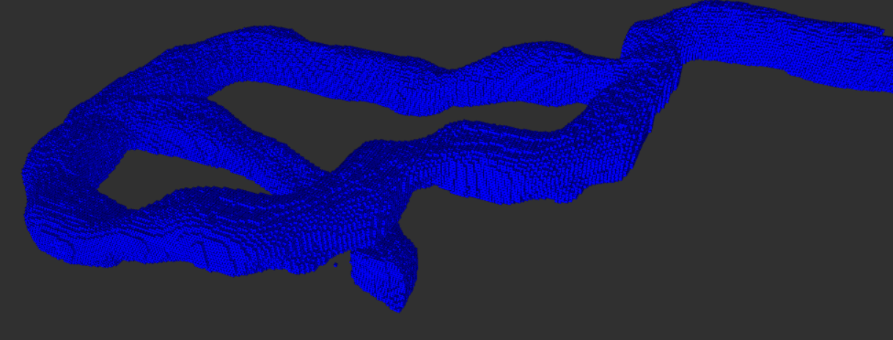
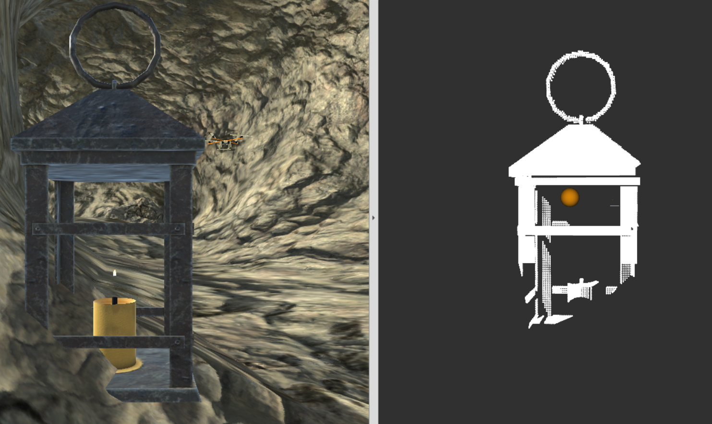

# Autonomous Systems 2025 - SubTerrain Challenge

## Team 1

*   Phil Chudalla
*   Moritz Heber
*   Henrik Huber
*   Daniel Platzner
*   Tom Schimansky

## Project

In this project, a drone explores a cave autonomously.

It navigates autonomously through the cave and simultaneously generates and outputs a 3D representation (voxel-grid) of the explored cave environment.



Additionally, four lanterns are located within the cave environment as quickly as possible. Their locations are published and recorded in a `lantern_positions.json` file.




## Installation

### System Requirements
*   Ubuntu 24.04
*   ROS 2 (Jazzy)

### Clone the repo

This repository includes a recording file of the whole cave exploration. Therefore cloning might take a few minutes.

### Install dependencies with rosdep

The first time using `rosdep`, it must be initialized via:

``` bash
sudo rosdep init
rosdep update
```

To install all dependencies, run the following commands:

``` bash
cd ros2_ws
rosdep install --from-paths src -y --ignore-src
```

### Build Workspace

```bash
cd ros2_ws
colcon build
source install/setup.bash
```

### Setup Simulation

Download the first provided simulation `Simulation.zip` from Sync&Share.

Copy the unpacked simulation files into the folder `ros2_ws/install/simulation/lib/simulation` and make `Simulation.x86_64` executable.

## How to Run

### All in One

We provide a simple bash script to start the Simulation and the State Maschine:

```bash
cd ros2_ws
./launch_all.sh
```

### Run separately

#### Simulation

First, open a new terminal, source the workspace, and launch the simulation:

```bash
cd ros2_ws
source install/setup.bash
ros2 launch simulation simulation.launch.py
```

The RViz visualization opens automatically. 

#### State Machine

Wait until the simulation is fully loaded (approx. 10 seconds). In a second terminal, launch the state machine to start the mission:

```bash
cd ros2_ws
source install/setup.bash
ros2 launch state_machine_pkg state_machine.launch.py
```

The drone flies to the cave and starts exploring. After exploration, it flies back to the cave entry to land. 


## Outputs

### Lantern Positions
The lantern positions are saved to the `lantern_positions.json` file in the `/ros2_ws` directory.
Additionally, they are published as MarkerArrays on topic `/lantern_location/detected_lanterns`.

### Map
The map is published as topic `/occupied_cells_vis_array`.

## Recording

A mcap recording of the whole cave exploration is provided in the `recording.zip` file. To view the recording `git lfs` is required to download the large file. 

If you haven't installed `git lfs` yet:

```bash
sudo apt update
sudo apt install git-lfs
git lfs install
git lfs pull
```

To run the recording, open `rviz` in the first terminal:

```bash
cd ros2_ws
source install/setup.bash
rviz2 -d src/simulation/config/visualization.rviz 
```

In a second terminal run the recording:

```bash
cd ros2_ws
source install/setup.bash
ros2 bag play ../recording/ --clock
```
